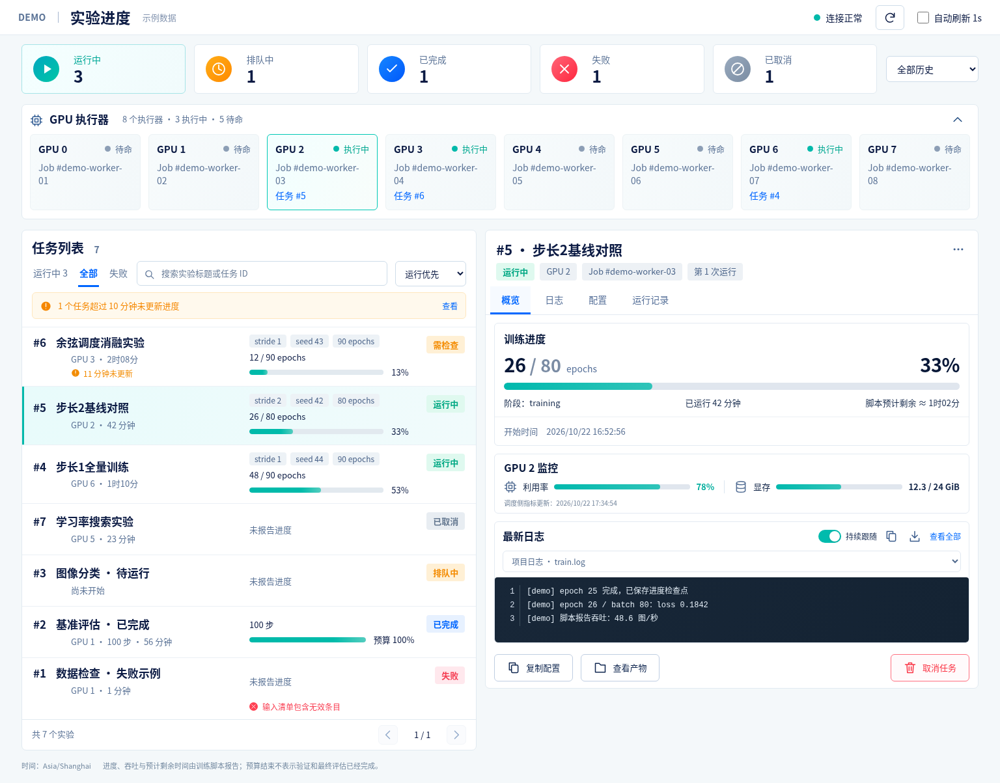

# Slurm Panel

The dashboard queries complete queue history with server-side filtering, sorting and pagination. Worker assignments cover all active jobs. Optional `GPU_METRICS_FILE` snapshots are exported by the scheduler; the backend does not probe GPU hardware. Set `PANEL_CLUSTER_NAME` for cluster branding and `PANEL_TITLE` for the page title (default: `实验进度`). See [data integration](docs/data-source.md) for snapshot formats and progress timestamp semantics.



[简体中文](README.md)

A read-only experiment dashboard built with **Node.js and pnpm**. It displays the actual gpuq tasks managed by persistent Slurm consumers, including training progress, attempt history and logs. The backend reads SQLite and local files directly, with no Python web service or third-party runtime dependencies.

The included demo uses fictional data and runs without Slurm, GPUs or gpuq. Live mode targets the custom gpuq SQLite schema described in [data-source.md](docs/data-source.md); connecting another Slurm deployment requires a matching adapter.

## Run the demo

Requires Node.js **24+** and pnpm **12.4.2**. See the [pnpm installation guide](https://pnpm.io/installation).

```bash
pnpm install --frozen-lockfile
pnpm demo
```

Open <http://127.0.0.1:5013>. The demo command forces fictional data even if `.env` selects live mode. Use `pnpm dev` for server watch mode; the frontend uses native ES modules and needs no build step.

## Connect a queue

```bash
cp .env.example .env
```

Set `PANEL_MODE=gpuq` and an absolute `GPUQ_DATABASE` path, then run `pnpm start`. The service account must be able to read the database, its WAL/SHM files, and the referenced progress/log directories. The database is opened read-only and is never initialized by this app. The external gpuq scheduler continues to handle task submission and scheduling.

Live responses include task commands, working directories, file paths and log content, which may be private. The default listener is loopback only. Provide access through a trusted network or an authenticated reverse proxy; this application has no login system. Keep real queue data and `.env` out of the published repository.

## Features

- Search and filter tasks, with state summaries and consumer heartbeats.
- View Slurm consumer IDs, attempts and exit status.
- Display script-reported epochs, batches, updates, losses, throughput and budget progress.
- Select and follow queue/project logs with periodic refresh.
- Responsive layout, configurable title, time zone and Slurm-web link.

The dashboard only reads data. It does not submit or cancel tasks, retry jobs, or probe GPUs. Script-reported budget progress does not establish that validation or final evaluation has finished.

## Configuration

| Variable | Default | Purpose |
| --- | --- | --- |
| `PANEL_MODE` | `demo` | `demo` or `gpuq` |
| `HOST` | `127.0.0.1` | Bind address |
| `PORT` | `5013` | HTTP port |
| `GPUQ_DATABASE` | unset | Required absolute database path in live mode |
| `PANEL_TITLE` | `Slurm Panel` | Page title |
| `SLURM_WEB_URL` | unset | Optional HTTP(S) Slurm-web link |
| `TZ` | unset | Optional IANA zone; otherwise the browser's zone |
| `REFRESH_INTERVAL_MS` | `5000` | Refresh interval in milliseconds |

See [configuration and API](docs/configuration.md), [data source](docs/data-source.md) and [deployment](docs/deployment.md). The detailed guides are in Chinese.

## Development

The source is organized into `src/server/`, `src/data/`, `public/`, `examples/`, `tests/`, `e2e/`, `deploy/` and `docs/`. `pnpm dev` needs no build step. `pnpm install` includes development dependencies; running the backend and frontend requires no third-party packages.

- `pnpm test` uses the built-in Node.js test runner.
- `pnpm test:browser` runs Playwright 1.61.1 browser regressions through `e2e/check-ui.js`.

Install Chromium once before running browser regressions:

```bash
pnpm exec playwright install chromium
```

In environments that require Slurm for test execution, submit both commands to the scheduler:

```bash
gpuq submit --name slurm-panel-tests --cwd /opt/slurm-panel -- pnpm test
gpuq submit --name slurm-panel-browser --cwd /opt/slurm-panel -- pnpm test:browser
```

Commit messages and Pull Request descriptions use Chinese. Do not commit real databases, logs, local environment settings or machine-specific deployment details.

The redesigned dashboard includes five separate status summaries, server-side filters and pagination, linked GPU executors, and four task detail tabs. See the [dashboard guide](docs/dashboard.md) for interactions and data-source boundaries.

## License

[MIT](LICENSE)
